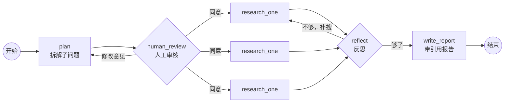

# DeepResearch：基于 LangGraph 的研究助手

输入一个研究主题，系统会自动完成以下步骤：

1. **拆解**成几个子问题
2. 停下来请你**人工审核**
3. **并行检索**：由模型自己选择联网搜索还是查本地知识库
4. **反思**资料够不够，不够就补搜
5. 写出**带引用来源**的研究报告

整个过程支持网页实时流式输出、断点续跑，并通过 LangSmith 记录每一步。

## 流程图



## 技术要点

| 能力 | 实现方式 |
|---|---|
| 状态图编排 | LangGraph `StateGraph`，用条件边实现两个循环：审核不通过时重新规划，资料不足时补搜 |
| 结构化输出 | Pydantic + `with_structured_output`，用于规划子问题（`Plan`）、选择工具（`Pick`）和反思（`Reflection`） |
| 并行检索 | `Send` API 动态扇出子任务（Map-Reduce），结果由 `operator.add` Reducer 合并 |
| Agentic RAG | 每个子问题由模型自己选择联网（DuckDuckGo）或本地知识库（bge-m3 向量检索） |
| Human-in-the-loop | `interrupt()` 暂停等待审核，`Command(resume=...)` 继续 |
| 持久化 | `SqliteSaver` checkpointer，按 thread 保存进度，服务重启后可以接着跑 |
| 防幻觉引用 | 资料编号后交给模型标注 `[n]`，参考来源列表**由代码生成**，不让模型自己写网址；资料先去重 |
| 防死循环 | 反思最多 `MAX_ROUNDS = 2` 轮 |
| 服务化 | FastAPI + SSE：`stream_mode=["updates", "messages"]`，进度和报告逐字推送到网页 |
| 可观测性 | LangSmith tracing，可以查看每个节点的耗时、token 用量和模型输入输出 |
| 模型可切换 | 通过 `common/llm.py` 统一获取模型，改配置即可在 DeepSeek 和本地 Ollama 之间切换 |

## 评测

知识库检索评测共 22 题（`eval/eval_kb.py`），指标为 Hit@k：前 k 个检索结果中包含标准答案的比例。

| 切块方式 | Hit@1 | Hit@3 |
|---|---|---|
| 每 150 字切一块 | 77% | 91% |
| 按 Markdown 标题切块，并在每块开头补充"文档 - 小节"标题 | **91%** | **100%** |

失败原因分析见 [eval/RESULTS.md](eval/RESULTS.md)。

## 快速开始

需要先安装：Python 3.11 及以上版本、[Ollama](https://ollama.com)（用于向量模型），以及一个 DeepSeek API Key。

```bash
pip install -r requirements.txt
ollama pull bge-m3
cp .env.example .env          # 在 .env 里填上 DEEPSEEK_API_KEY
```

**网页版：**

```bash
uvicorn deep_research.api:app --reload
# 浏览器打开 http://127.0.0.1:8000
```

**命令行版：**

```bash
python -m deep_research.cli
```

**Docker：**

```bash
docker compose up --build    # 向量模型使用宿主机上的 Ollama；Key 从 .env 读取，不会打进镜像
```

**测试和评测：**

```bash
python -m pytest -v          # 单元测试，不调用模型
python -m eval.eval_kb       # 知识库检索评测
```

## 项目结构

```
deep_research/
├── graph.py         主流程图：规划 → 审核 → 并行检索 → 反思 → 写报告
├── tools.py         联网搜索 + 本地知识库，统一返回 {source, text}
├── api.py           FastAPI 接口：/start、/resume（SSE 流式）
├── cli.py           命令行入口
└── static/index.html  网页界面
common/llm.py        统一的模型与 Embedding 工厂
config/local.yaml    模型配置
knowledge/           本地知识库文档（虚构公司"星辰科技"的制度与产品）
tests/               单元测试
eval/                检索评测集与评测记录
lessons/             学习过程中每天的练习代码（Day2 ~ Day10）
```
